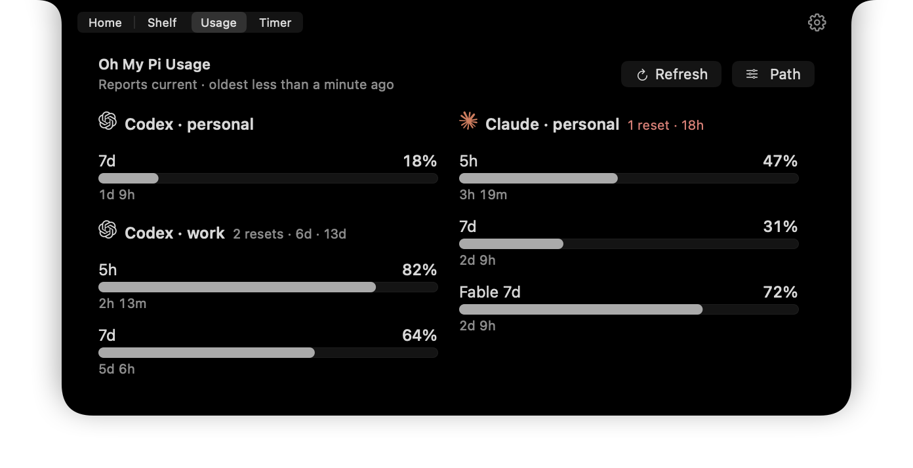
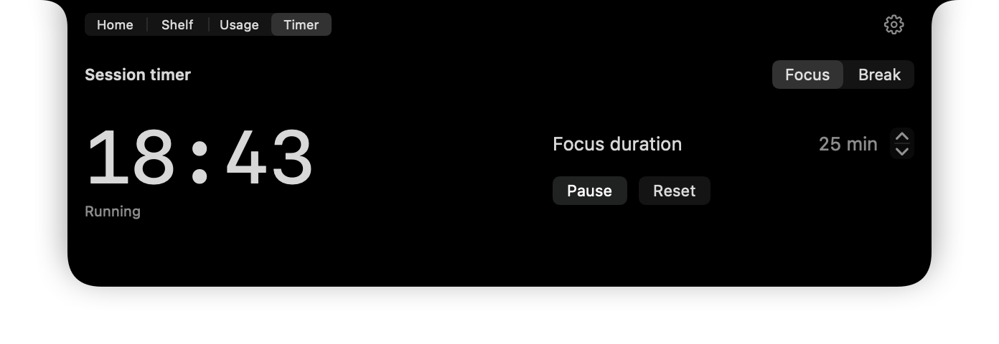
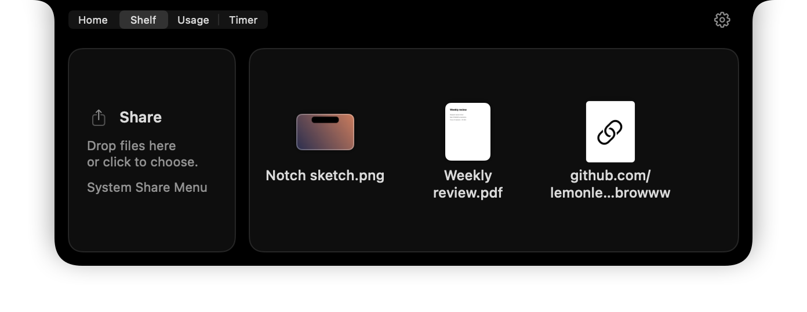

<div align="center">

# Browww

**A personal control plane in the MacBook notch.**<br>
AI usage limits, a session timer, a quiet Shelf and your calendar — one hover away.

[](https://github.com/lemonleks/browww/actions/workflows/ci.yml)
[](#install)
[](https://developer.apple.com/xcode/swiftui/)
[](LICENSE)



</div>

Browww is a native SwiftUI fork of [Boring Notch](https://github.com/TheBoredTeam/boring.notch). It keeps what Boring Notch does well — Now Playing, the HUD replacement, the Shelf and the calendar — and adds a few daily workflows on top: AI usage limits, a session timer, calmer drag-and-drop and Notion Calendar links. Everything lives in one native panel behind the notch.

<table>
  <tr>
    <td width="50%"></td>
    <td width="50%"></td>
  </tr>
  <tr>
    <td align="center"><b>Session timer</b></td>
    <td align="center"><b>Shelf</b></td>
  </tr>
</table>

## Features

### Oh My Pi usage

Limits for every account signed in to [Oh My Pi](https://github.com/can1357/oh-my-pi) (`omp`), at a glance.

- **Codex on the left, Claude on the right.** Each account stays in its provider's column; other providers follow below.
- Each limit shows what is **left**: percentage, bar and a compact reset countdown such as `6d 8h`. Exact reset times are in hover help and VoiceOver.
- **Banked resets** sit next to the account name — `2 resets · 6d · 13d` — and turn muted coral when one expires within 24 hours. Empty balances stay hidden.
- **Honest freshness.** Ages come from each report's `fetchedAt`; data older than five minutes is marked stale, and a failed refresh keeps the last good snapshot.
- Opening the tab refreshes at most once a minute; the OMP cache is also checked every minute and on wake. **Refresh** forces `omp usage invalidate`.
- `omp` is found automatically (Bun, Homebrew, npm and user bins, `PATH`) or set with **Path**.

### Session timer

A deliberately small focus timer — no account, history or app blocking.

- **Focus** or **Break**, 1–180 minutes (25 and 5 by default), with **Start**, **Pause/Resume** and **Reset**.
- Deadline-based: it stays correct with the panel closed, through sleep and across restarts.
- A macOS notification when time is up. Also available from the menu bar as **Session Timer**.

### Shelf and drag-and-drop

- Drop files or links **on the closed notch** to keep them for later; drag them back out, share them or open Quick Look.
- A tight drop target: the closed notch plus a 12-point margin, not the whole panel area.
- Hovering previews the Shelf without switching tabs. The Shelf becomes the selected tab only after something is actually added.
- **Share** sends files with the macOS sharing service of your choice.

### Calendar and Notion Calendar

- Agenda from calendars already synced to macOS (Google, iCloud).
- Events open in **Notion Calendar** when the account email and calendar are known, otherwise in Apple Calendar. No Notion tokens.
- If macOS cannot tell which account an event belongs to, enter the email you use in Notion Calendar under **Settings → Calendar**.

### Everything from Boring Notch

Now Playing with controls and a visualizer (Apple Music, Spotify, YouTube Music and system Now Playing), the volume, brightness and keyboard-backlight HUD, camera mirror, battery and charging status, reminders and gestures. The Home, Shelf, Usage and Timer tabs are remembered between launches and switch with a two-finger horizontal swipe.

## Install

Browww is built from source. You need an Apple silicon Mac with macOS 14 or later and Xcode 26.

```sh
git clone https://github.com/lemonleks/browww.git
cd browww
xcodebuild -project boringNotch.xcodeproj -scheme boringNotch -configuration Release \
  -derivedDataPath .build CODE_SIGN_IDENTITY=- DEVELOPMENT_TEAM= build
cp -R .build/Build/Products/Release/Browww.app /Applications/
```

The build is ad-hoc signed and uses its own bundle identifier (`local.browww`), so it shares neither settings nor updates with Boring Notch. macOS asks for permissions when a feature needs them: Calendar (Full Access for the agenda), Notifications for the timer, and Accessibility for the HUD and media keys.

For **Usage**, install [Oh My Pi](https://github.com/can1357/oh-my-pi) and sign in to your providers with `omp` first.

## Privacy

- No accounts, analytics or credential storage. Usage is read through your local `omp`.
- The app is sandboxed. A bundled XPC helper runs only the fixed `omp usage` and cache-invalidation commands — no shell and no arbitrary arguments.
- Usage never sends prompts or spends reset credits.

## Development

```sh
scripts/check.sh            # logic checks, no build needed
scripts/check.sh --native   # plus real-view checks against the Debug build in .build
```

The native checks need a Debug build:

```sh
xcodebuild -project boringNotch.xcodeproj -scheme boringNotch -configuration Debug \
  -destination 'platform=macOS,arch=arm64' -derivedDataPath .build \
  CODE_SIGN_IDENTITY=- DEVELOPMENT_TEAM= build
```

The checks are plain Swift executables rather than an XCTest target. Native checks render the real views in invisible windows with an isolated home directory; they never send input to the desktop. [CI](.github/workflows/ci.yml) builds the app and runs all of them on every push.

- `boringNotch/ControlPlane/` — Oh My Pi usage and the session timer.
- `Tests/` — the standalone checks run by `scripts/check.sh`.
- The Xcode project and source folders keep the upstream `boringNotch` names, so upstream changes merge cleanly:

  ```sh
  git remote add upstream https://github.com/TheBoredTeam/boring.notch.git
  git fetch upstream && git merge upstream/main
  ```

  Upstream's release, update and translation infrastructure is intentionally not part of this fork; keep it deleted when merging.

## Credits and license

Browww is free software under the [GNU GPL v3](LICENSE), like the project it builds on.

- [Boring Notch](https://github.com/TheBoredTeam/boring.notch) by The Bored Team and contributors — the foundation of this app, forked at [`d58240c`](https://github.com/TheBoredTeam/boring.notch/commit/d58240cc160d5e54da1a8a5925e095d067a8e1e0).
- [ClaudeBar](https://github.com/tddworks/ClaudeBar) (MIT) — the Oh My Pi usage parsing is adapted from its `OmpUsageProbe`.
- [MediaRemoteAdapter](https://github.com/ungive/mediaremote-adapter), [NotchDrop](https://github.com/Lakr233/NotchDrop), Calendr, DynamicNotchKit, Parrot and [Simple Icons](https://simpleicons.org) — see [THIRD_PARTY_LICENSES](THIRD_PARTY_LICENSES).

Browww is a personal project and is not affiliated with The Bored Team, OpenAI, Anthropic or Oh My Pi. Product names and marks belong to their owners.
